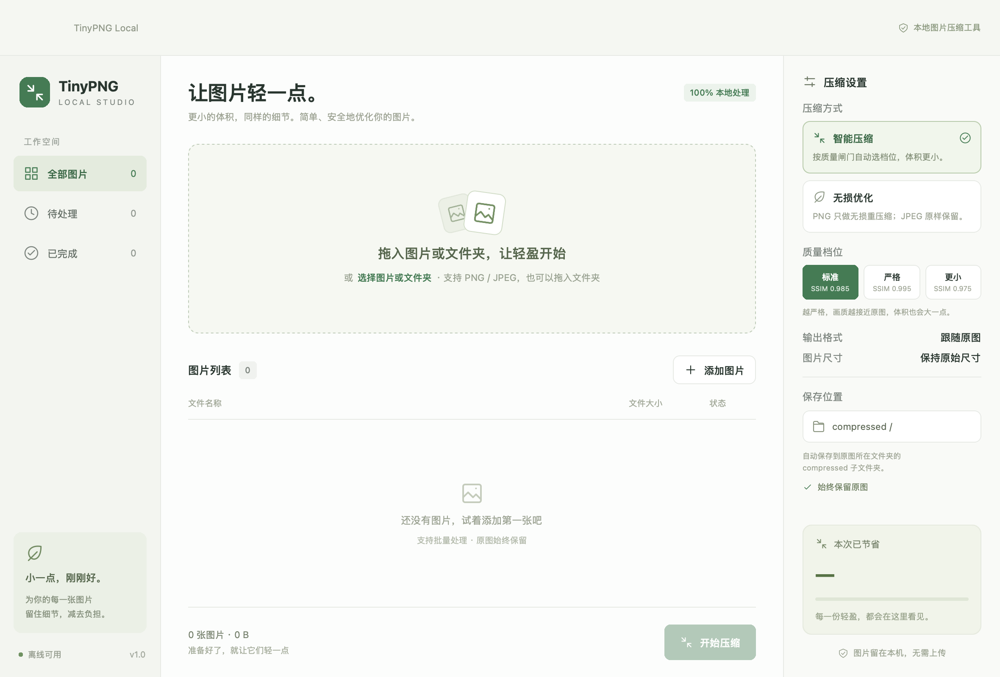
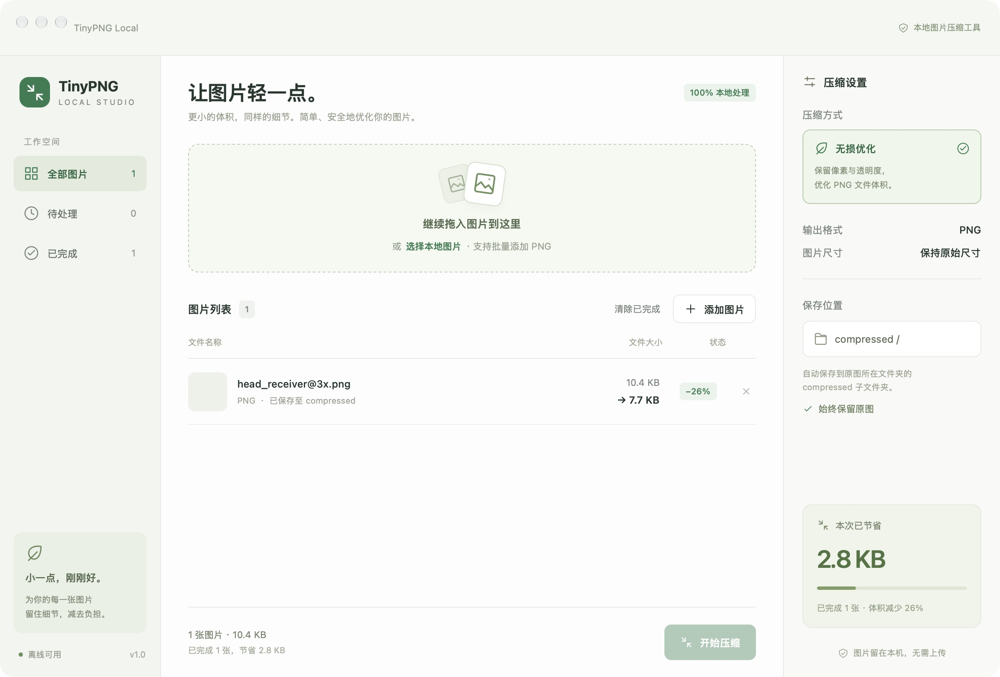

# ImgSquash

[](https://github.com/zhuolingzhao007/imgsquash/releases/latest)
[](https://github.com/zhuolingzhao007/imgsquash/actions/workflows/windows.yml)
[](LICENSE)

**本地图片压缩工具 —— 更小的体积，同样的细节。**

拖入图片，剩下的交给它。PNG / JPEG 智能压缩、无损优化、WebP 转换，全部在本机完成。图片不上传，隐私零顾虑。

<p align="center">
  
</p>

## 特性

- **智能压缩** —— 逐张分析图片内容自动选择参数，感知质量评分闸门把关：体积变小，观感不变。
- **无损优化** —— PNG / JPEG 无损减体积，像素一个字节都不变。
- **WebP 输出** —— 智能模式下可选 WebP，照片类图片体积进一步大幅下降。
- **细节原样保留** —— ICC 色彩配置、透明通道、动画帧、EXIF 方向，该保的都保，不静默偷工。
- **批量处理** —— 拖入整个文件夹，批量压缩，原图永远保留。
- **大图友好** —— 超大原图自动走低内存路径，不炸内存。
- **100% 本地** —— 无账号、无上传、无追踪。
- **原生双平台** —— macOS（Apple Silicon）与 Windows，系统级原生界面。

## 下载

从 [**Releases**](https://github.com/zhuolingzhao007/imgsquash/releases/latest) 页面下载：

| 平台 | 文件 | 说明 |
| --- | --- | --- |
| macOS | `imgsquash-*-macos.zip` | 解压后将 App 拖入「应用程序」。未签名，首次打开请右键 →「打开」 |
| Windows | `imgsquash-*-windows.zip` | 解压后运行 `imgsquash.exe` |

## 使用

1. 拖入图片或文件夹（支持 PNG / JPEG）
2. 选择压缩方式：智能压缩或无损优化；智能压缩下再选质量档位（标准 / 严格 / 更小）
3. 点击「开始压缩」——结果保存在原图所在目录的 `compressed/` 子文件夹，同名自动加序号，永不覆盖

<p align="center">
  
</p>

## 从源码构建

依赖 [Rust](https://rustup.rs) 与 [nsh](https://nsh.dev)：

```sh
git clone https://github.com/zhuolingzhao007/imgsquash.git
cd imgsquash/app
./scripts/dev.sh          # 开发调试（macOS）
nsh test                  # 运行测试
./scripts/package.sh      # macOS 打包
scripts/package.ps1       # Windows 打包
```

## 文档

- [技术实现详解](docs/TECHNICAL.md) —— 压缩核心流程、评分漏斗、大图低内存处理、质量策略
- [设计与决策记录](app/docs/plans/) —— 架构演进的完整过程

## License

[MIT](LICENSE)
