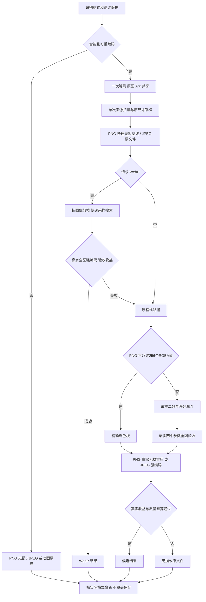

# 智能压缩流程与性能改造

复杂度 L3：调整内容分析、参数搜索与最终验收的数据流，保留 `Compress.auto`、现有界面和安全保存边界。

文件入口已补充[大图低内存流程](2026-10-27-large-image-design.md)：先做语义保护与路径选择，再按路径准入。以下完整解码/全图 SSIMULACRA2 流程适用于常规路径；超预算或超 128 MiB 输入走扫描线与独立的分块验收，最多两个全图参数的预算保持不变。

## 目标与方案

目标是用有限的工作量产出更小且满足当前档位质量预算的图片。编码参数和评分都是手段，不能把更多候选、最高编码强度或最低 quality 当作目标。

第一轮提速前（e65d2a8），每个候选都在全图上量化/编码、SSIMULACRA2 评分，PNG 再逐个执行 oxipng。UI 实图约 7.63 秒，其中全图评分约占 44%，PNG 优化（含基线）约占 46%。基线原本是 oxipng preset 2，使用 libdeflater，并非最高强度或 Zopfli。

比较过两种方案：

| 方案 | 成本 | 质量与扩展边界 |
| --- | --- | --- |
| 保留全图候选，只降低编码强度或并行执行 | 修改少，仍会重复处理数百万像素 | 重复评分的成本不变；批量与候选并行容易争抢资源 |
| 共享原图与画像，在原尺寸采样块上搜索，最终全图验收（采用） | 增加画像与采样机制，每条有损路径最多两个全图参数 | 采样存在偏差，必须保留最终验收和回退；不保证全局最优 |

不是照搬 TinyPNG 的内部实现。公开原理可以参考，但其参数搜索与重试细节没有公开。

## 数据流



具体顺序由格式保证正确性：PNG 的量化结果可直接展开成实际输出像素，因此先全图评分、通过才强编码；JPEG/WebP 的编码设置可能改变像素，因此直接对选中参数强编码，再回读做一次完整验证，不假定快慢档像素相同。

“最多两个”指每条有损编码路径的全图参数数目，不包含快速无损基线、无损回退、格式转换失败后原格式的独立处理。小图可能直接以原图为样本，此时采样工作也发生在全分辨率，但像素量有明确上限。

## 画像、剪枝与复用

- `analysis::Profile` 一次扫描得到 alpha、灰度、最多 256 个精确 RGBA 色值及其索引、平坦区比例和边缘密度。超过 256 色就停止维护唯一色集合，避免照片的巨大颜色表。
- 相邻像素在黑/白背景上的可见最大通道差 ≤2 记平坦，≥32 记边缘。当前图形启发式为平坦比例 >85% 且边缘 >1%；无 alpha、平坦比例 <75% 且边缘 <30% 视为照片，其余保留为混合内容。分类只是优化路径，不能作为画质结论。
- 不超过 256 个 RGBA 值直接精确索引，不经过有损量化。隐藏 RGB 和 alpha 仍按原始 RGBA 保存。
- 明确的图形不尝试 WebP 有损 DCT；JPEG 中明确的图形保留原文件。照片 PNG 跳过低色数，只保留一次 256 色误差扩散尝试。项目照片实测它能把约 1.21 MB 压到约 281 KB，因此没有把所有照片调色板路径删掉。
- PNG 保持原格式且输入小于 2 KiB 时仅快速无损。JPEG 小于 2 KiB 或可信质量 ≤75 时直接保留，包括显式请求 WebP 时；这是避免二次有损的产品取舍，可能错过部分转换收益。
- JPEG 从 DQT 严格匹配 IJG 标准缩放量化表才返回质量因子；不匹配、16 位表、重复/未知表均返回未知。自定义 mozjpeg 表不套平均比例猜质量，也不据此拒绝重编码。
- 大图在 128×128 网格中选择渐变优先的平坦块、边缘块、纹理块各一块，去掉重复位置，保留原始分辨率，最多形成 384×128 样本。最大边 ≤128 或最小边 <8 的图直接共享原图。平坦块要求至少 90% 像素的相邻差 ≤2，在其中优先选择非零小变化密度最高者；没有平坦块时才退回原来的最平坦规则。小变化计数复用画像扫描，排除网格边界，避免块外突变造成误判。
- `Analyzed` 用 `Arc` 共享像素和样本；画像只建一次。PNG 转 WebP 若需要烘入方向，则额外生成方向变换后的分析对象，保留原坐标对象用于同格式 PNG 回退。编码器内部解析及输出回读不属于“业务原图只解码一次”的保证。
- `quantize::Prepared` 建一次全图直方图，各颜色数的结果按参数缓存。采样与全图使用同一个全图调色板，避免只用样本建调色板而低估全局颜色需求。quantizr 的分裂结果随目标颜色数改变，不能安全地截断 256 色树得到 128/64 色树。

## 搜索与评分

`search::bounded` 接收范围、预算和测量闭包，不识别格式。先验证高质量端，再用最多四次中点探测收窄区间；已测可行点按样本成本排序（成本相同才按字节数、参数稳定排序）。漏斗返回已有 Metrics，编码闭包将其换算为成本，search 只识别字节数与有限成本；不可行点记正无穷。PNG/JPEG/WebP 均最多五次不同参数探测，照片 PNG 只有一次。WebP 的中点预估与二分首个中点相同，缓存复用。

候选质量/体积只大体单调。探测失败可缩小区间，但不能证明被跳过的参数不可用；快速排名也可能反转。前两名快速体积相差 ≤2% 时都做全图处理，按强编码后的真实成本比较。否则通常只处理首选；首选质量不通过时用实测偏差校准剩余已探测点，再选择第二参数；仍不通过则回退。不会把相同参数做两次全图编码。

样本成本与最终验收使用同一公式，但字节比需要匹配参照：PNG 多候选路径单独建立一次同样本的快速无损参照（本次 UI 样本约 8 ms）；照片只有一个 256 色点，不需要为排名编码样本参照，复用像素量换算。不能拿集中于细节的样本与整图平均 bpp 直接比较，否则大面积留白会放大颜色数的体积代价。JPEG/WebP 继续按全图基线和样本/全图像素比例估算字节比，最终只用实际全图字节数验收。比率估计仍有偏差，不代表全图成本的精确预测。

采样评分漏斗：

1. 亮度 RMSE 和黑/白背景可见颜色/alpha RMSE，先拒绝明显失真，防止亮度相同的换色绕过检查。
2. 亮度积分图的 8×8 SSIM（步长 4），时间 O(n)，积分缓冲跨候选复用。
3. 仅对通过的样本计算 SSIMULACRA2 和局部误差，分别检查结构预算与独立局部上限，并将已有度量返回给成本选择。普通 SSIM 对平滑色带不够敏感，实测必须补这一层。样本像素很少，仍显著便宜于逐候选全图评分。
4. 样本使用完整失真预算的 85%，给未采到区域留余量；最终全图验证不省略。

PNG 评分直接使用调色板展开像素，不编码后再解码。JPEG 没有引入不可靠的 Parseval 近似：现有接口未提供可验证的 DCT 系数域误差，搜索仍回读小样本。JPEG RGB 缓冲复用，未创建通用缓冲池。

## 快慢档与收益

- PNG 快速无损用 oxipng preset 0；样本调色板 PNG 使用快速熵编码，搜索不跑 oxipng。最终或无损回退使用 preset 2，底层仍是 libdeflater。没有开启 Zopfli。
- 没有采用 preset 6 作为最终档：关闭内部并行后，UI 样本单次 preset 6 重压约 6.73 秒，照片约 1.63 秒，抵消前面的优化。同图 preset 2 的重压分别约 .48 秒 / .20 秒，代价是比 preset 6 多 3,374 B / 595 B。采用均衡档，不承诺最高压缩率。
- JPEG 搜索关闭扫描优化，最终启用 progressive 和扫描优化；沿用原色度抽样，ICC 只写最终输出。WebP 使用 method 0 搜索、method 6 输出，alpha quality 100、exact=true。
- 照片跳过无损 WebP；其余建立快速无损 WebP，最终必要时再强编码。中间质量的样本 bpp 外推包含 ICC 大小，预计达不到最低收益就停止。PNG/JPEG 暂不使用未经校准的 bpp 进行早期拒绝，直接对有限全图结果判断收益，避免不同熵编码/元数据比例造成额外误剪。
- WebP 比较基线包含原格式的快速无损结果；无损 WebP 可用时再取两者较小者。不能只与未经优化的 PNG 比较。PNG 压缩 ICC、WebP 存储 ICC 原文，转换会膨胀色彩元数据，必须计入体积。

最终选择沿用实际率失真成本，并按本次要求增加档位失真上限：

```text
D = max(100 - SSIMULACRA2, 0) / 100
局部约束 = 最差8×8可见误差RMSE ≤ local_rmse
C = 最终字节数 / 基线字节数 + 权重 × D
```

| 档位 | 样本亮度/可见 RMSE 上限 | 独立局部 RMSE 上限 | 样本 SSIM 下限 | 全图 D 上限 | 最低有损节省 | 成本权重 |
| --- | --- | --- | --- | --- | --- | --- |
| 严格 | 5 / 12 | 24 | .98 | .12 | 3% | 5 |
| 标准 | 8 / 22 | 44 | .95 | .24 | 2% | 2 |
| 更小 | 12 / 32 | 64 | .92 | .32 | 1% | .8 |

最终必须同时满足质量预算、最低节省和 C<1。无损结果不套有损最低节省比例。参数是尚未主观校准的产品设置，不能承诺视觉无损；采样与最终结果分别按对应成本选择，局部约束在成本排名前独立检查；局部上限从全局可见 RMSE 的 2 倍起步，尚未经过完整主观校准。预算不再与局部 RMSE/255 混用。

## 并行与计时

现有队列按图片并行：最多 `min(核数,4,任务数)`，批次最大输入大于 8 MiB 时上限 2。关闭 oxipng 和 SSIMULACRA2 的内部 Rayon，候选按搜索依赖顺序执行，没有新增候选线程池，避免嵌套并行。单张图也不为最多两个最终参数新增线程池：当前重点是删除重复工作。

设置 `TINYPNG_PROFILE=1` 开启每张图独立的阶段计时，默认关闭，不持有全局状态。记录解码、画像、直方图、基线、候选量化/编码/展开/回读/漏斗、最终验证/优化，以及最终分数与局部误差。日志按单图一次输出，嵌套阶段不能重复相加。运行命令见 README。

结果缓存是可选项，本轮未加入跨任务 hash 缓存；不存在缓存失效、文件内容变化和版本升级的额外状态。

## 保持的正确性边界

- 动画保留原样；16 位 PNG 只无损；CMYK/灰度 ICC JPEG 保留原样，灰度 ICC PNG 只无损。不能表达的 PNG 色彩描述阻止 WebP 转换。
- PNG 同格式保留 iCCP/sRGB/gAMA/cHRM/cICP/pHYs/eXIf，包括 IDAT 后的 eXIf；oxipng 默认不剥离其他辅助块。
- WebP 的 ICC 使用解压后的原文，写后按字节回读；无损 WebP 回读比完整 RGBA。
- JPEG ICC 拒绝缺段、重复与总数不一致；支持历史 0 起序号，输出统一 1 起。方向烘入像素，90°/270° 时交换抽样轴，Cb/Cr 分别继承抽样。
- 最终路径再次校验、按真实格式确定扩展名。同目录 tempfile + persist_noclobber，撞名重试后缀，不覆盖原图或已存在文件；该接口不保证整个发布操作原子。
- SSIMULACRA2 按 sRGB 假设测量，未做 ICC 色域转换，宽色域的绝对评分不能视为校准结论。JPEG 不承诺其余 EXIF/XMP/IPTC，WebP 只传 ICC。

## 架构检查

- 稳定机制：`analysis` 管画像/采样，`quality` 接收外部限值完成测量，`search` 管探测预算，`pipeline` 管最多两个最终候选及回退。它们通过值和闭包组合，不含具体编解码器判断。
- 变化策略：`policy` 集中档位预算/余量/收益/成本；格式模块决定参数范围、内容剪枝、编码强度和元数据约束。策略变更不改搜索或最终候选循环。
- 变化场景测试：相同搜索和最终验收机制分别接入 PNG 颜色数、JPEG/WebP quality；测试覆盖非单调快速体积、近似平手排名翻转、候选失败、重复参数和一次/两次全图预算。
- 抽象删除测试：删掉 search/pipeline 会在三个格式中复制预算、排序与回退；这两层有真实复用。没有引入协议、编码器工厂或单纯转发层。精确调色板构建已从 Prepared 的重复扫描移到一次画像。
- 有副作用的编解码、计时、文件发布留在应用边界；核心画像、评分、策略与搜索可独立测试。

## 工具与许可

继续使用 quantizr 1.4.3（实际 LICENSE 为 MIT）、oxipng 7（MIT）、mozjpeg 0.10（IJG 类）、webpx 0.4.1（MIT/Apache-2.0）与 libwebp（BSD-3-Clause）、ssimulacra2 0.5（BSD-2-Clause）。本轮未引入依赖；关闭 oxipng 默认功能还移除了无用的 CLI/Zopfli 依赖。分发仍需保留相应声明。

## 第一轮提速的验证与性能（edb3ea1 历史记录）

2026-10-27 本机 release，基线是本轮改造前的代码。旧版为单次墙钟计时；当前配置连续测三次取中位数：UI 为 1.915/1.871/1.876 秒，照片为 .603/.615/.661 秒。计时包含启用阶段日志的轻微开销，仅说明这两个样本的量级，不代表所有图片。

| 标准档 / 图片 | 原文件 | 改造前 → 后体积 | 感知分前 → 后 | 耗时前 → 后 |
| --- | --- | --- | --- | --- |
| UI PNG，2360×1600 | 363,588 B | 87,684 → 76,080 B | 88.21 → 80.54 | 7.63 → 1.88 s |
| 照片 PNG，1005×756 | 1,211,984 B | 280,878 → 280,878 B | 78.47 → 78.47 | 2.36 → .61 s |

照片在体积/评分相同的情况下约快 3.8 倍。UI 约快 4.1 倍且体积更小，但画质更激进，不能把全部变化都归因于纯性能优化。

当前照片格式/档位对照：标准 WebP 130,208 B、分数 78.01、约 .51 秒；更小 WebP 89,456 B、分数 70.9、约 .70 秒（首选全图失败，回退 q76）；严格档拒绝有损 PNG/WebP，保留原格式无损 1,011,397 B、约 .78/.80 秒。这些结果不能作为普遍压缩率保证。

验证：核心 28 项；`nsh test` 66 项通过（44 Rust + 22 TS），2 项真实图片基准默认跳过，已显式执行；共 94 项非基准测试通过。`nsh check`、两个 crate 的 `cargo clippy --all-targets -- -D warnings`、格式与差异检查通过。新增回归包括全图预算、快速排名反转、次优回退、全图/采样调色板一致性、相同亮度换色、大片天空分类、标准/自定义 JPEG 表、PNG/WebP ICC 体积基线。

Windows 编译、运行与打包仍需 Windows CI/机器验证；本轮没有修改界面结构或重新打包安装应用。

## 本次选点修正

本轮保持最多五次候选探测、每条有损路径最多两个全图参数。修复成本仅作最后接受判据的问题；为局部 RMSE 设置独立上限；平坦采样优先非零缓慢变化。未增加 OKLab、p99、新编码器或候选线程池。

验证要求：同一组五个探测点上改变档位权重会改变首选；局部超限不能被很好的全局分抵消；纯色块与渐变块同时存在时优先选择渐变；采样与全图验收继续共享策略，成本计算不重复评分。

本机 release 对照修改前的 edb3ea1；均为单次墙钟计时，仅说明这些样本，不能作为所有图片的性能或主观画质保证：

| 图片与档位 | 字节数：修改前 → 后 | 感知分：前 → 后 | 耗时：前 → 后 |
| --- | --- | --- | --- |
| UI PNG，标准 | 76,080 → 83,591 | 80.54 → 87.15 | 1.90 → 1.92 s |
| UI PNG，更小 | 76,080 → 76,080 | 80.54 → 80.54 | 1.76 → 1.79 s |
| UI PNG，严格 | 88,613（有损）→ 197,879（无损） | 88.35 → 100 | 2.52 → 2.85 s |
| 照片 PNG，标准 | 280,878 → 280,878 | 78.47 → 78.47 | 约 .60 s，基本相同 |
| 照片 WebP，更小 | 89,456 → 89,456 | 约 70.9，保持相同 | .68 → .47 s |

标准 UI 图增加约 9.9% 输出字节，换取更高感知分。照片更小 WebP 不再先尝试 q67 后失败回退，而是直接选择 q76，全图参数数由 2 降为 1。相同权重的有限样本仍可能得到原结果，不能保证“更小”档的每张图都变好。

严格 UI 是必须保留的反例：成本排名选择的 91 色与 256 色点全图分数分别为 87.96 / 87.35，未达到严格档的 88 分底线；局部误差均通过。原先可用的 136 色点（88.35 分，局部 RMSE 21.97）虽然经过了样本探测，但没有排进本轮两个全图候选。这里的回退来自采样排序偏差和两次全图预算，不能解释为局部上限带来的改善，也不能宣称回退概率已经降低。保留无损保障结果正确性；若要保证找回这一类候选，需要单独评估更好的采样预测或额外的全图预算，不在本轮三项修改中偷加编码次数。

当前局部上限 24/44/64 是从建议的 2 倍起点出发，现有少量实图与合成回归不足以完成主观校准，也不足以证明局部约束在实际数据中的触发频率。用预设边界测试验证独立约束，以实图报告收益和退化，不能用二者替代完整视觉验收。

验证：核心库 33 项、应用 Rust 44 项、TS/原生调用 22 项，共 99 项非基准测试通过；两个真实输入的多档/格式基准显式执行。`nsh check`、两份 Clippy 严格检查、格式检查与 `git diff --check` 通过。WebP 比较测试改用真实无损编码长度作为体积基线，保留原先“至少减半”的断言；RGBA 内存长度不能作为率失真成本的压缩文件基线。

架构检查：搜索仍只处理参数预算和外部提供的成本，格式判断留在编码闭包；局部约束和结构预算在 policy 中分别定义；evaluate 返回已算出的 Metrics 供排名复用。没有增加协议、工厂或编码器层，也没有添加 OKLab/p99。

## 后续：两次全图预算内的失败反馈校准

上面的严格档退化是校准前的历史对照，当前已经修复。诊断确认 91/256 色是全图 D 超标，并非 3% 节省或成本拒绝；仅在原样本上乘统一倍率仍会错误选择 256 色。经用户确认，当前只在首次质量失败后补充受损区域小块评分，再用全图实测值校准，第二全图改选 136 色。

实际输出恢复为 88,613 B、88.3462 分，全图 D=.11653792、C=.98686483；全图参数仍为 91 → 136，没有增加第三次尝试。完整五个样本、旧首选/次选与新预测表、零误差处理和真实图片回归见[失败后校准文档](2026-10-27-sample-bias-calibration.md)。
